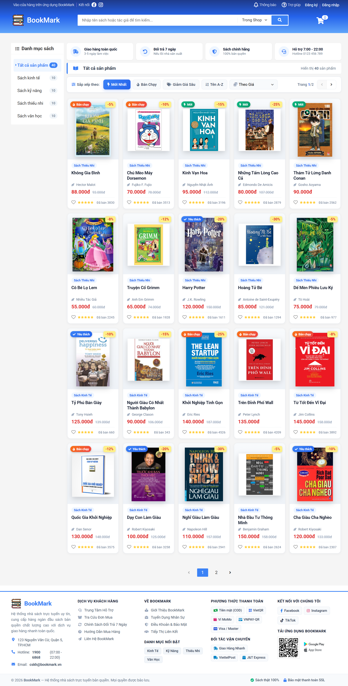
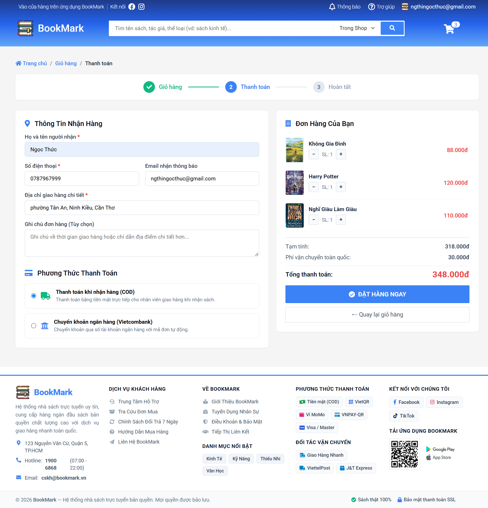
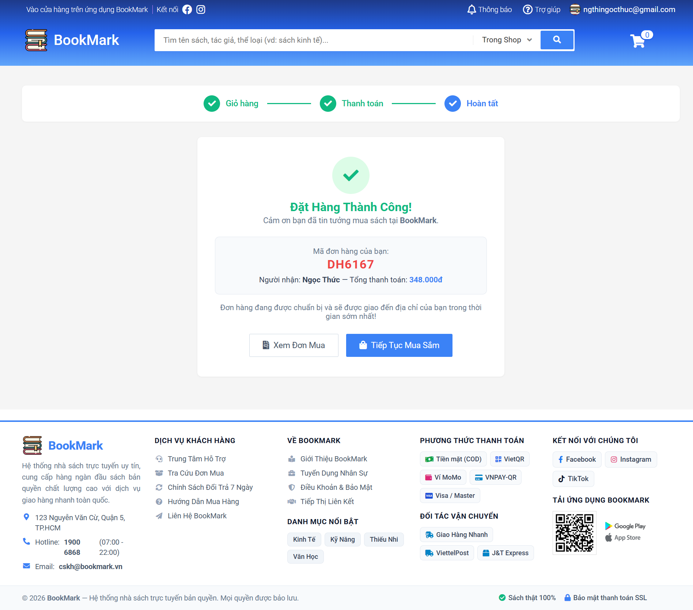
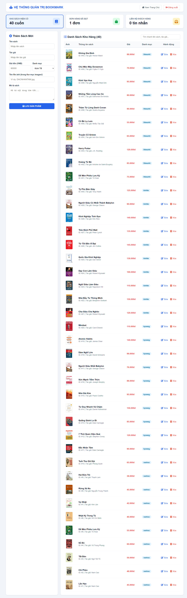
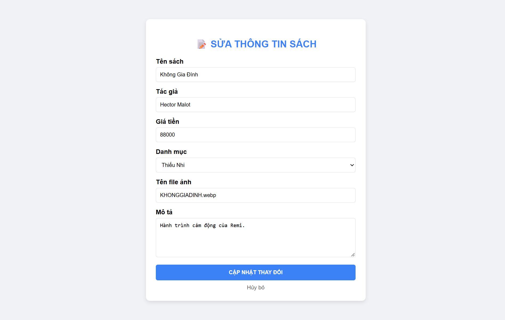

# BookMark - Hệ Thống Nhà Sách Trực Tuyến

**BookMark** là website thương mại điện tử chuyên cung cấp các đầu sách bản quyền đa dạng thể loại, được xây dựng bằng **PHP** và **MySQL**. Hệ thống đáp ứng trọn vẹn quy trình mua sắm trực tuyến cho độc giả cùng giao diện quản trị kho hàng, đơn đặt hàng dành cho quản trị viên.

## Tính năng nổi bật

### 1. Phân hệ Khách hàng (Storefront)
* **Danh mục & Bộ lọc thông minh:** Quản lý và phân loại 40 đầu sách theo 4 nhóm chính (**Sách kinh tế**, **Sách kỹ năng**, **Sách thiếu nhi**, **Sách văn học**) kết hợp phân trang.
* **Tìm kiếm & Sắp xếp:** Tìm kiếm nhanh theo từ khóa tên sách/tác giả/thể loại và sắp xếp theo *Mới nhất, Bán chạy, Giảm giá sâu, Tên A-Z, Theo giá*.
* **Xem nhanh chi tiết (Quick-view Modal):** Hiển thị trực quan ảnh bìa, tác giả, đánh giá sao, lượt bán, giá ưu đãi, tóm tắt nội dung và chọn số lượng thêm vào giỏ.
* **Tài khoản người dùng:** Hỗ trợ đăng ký/đăng nhập với kiểm tra điều kiện mật khẩu mạnh và mã xác thực Captcha.
* **Quy trình đặt hàng 3 bước khép kín:**
  1. **Giỏ hàng:** Cập nhật số lượng, xóa từng sản phẩm hoặc xóa tất cả, tự động tính tạm tính và phí vận chuyển.
  2. **Thanh toán:** Nhập thông tin giao hàng, hỗ trợ thanh toán khi nhận hàng (**COD**) hoặc chuyển khoản ngân hàng (**Vietcombank**).
  3. **Hoàn tất:** Cấp mã đơn hàng tự động và lưu trữ lịch sử đơn mua.

### 2. Phân hệ Quản trị viên (Admin Dashboard)
* **Thống kê tổng quan:** Theo dõi nhanh số lượng đầu sách trong kho, số đơn hàng đã đặt và liên hệ từ khách hàng.
* **Quản lý kho sách (CRUD):**
  * Thêm đầu sách mới trực tiếp ngay trên bảng điều khiển (`admin/admin.php`).
  * Cập nhật chi tiết thông tin sách, giá bán, danh mục, hình ảnh và mô tả (`admin/edit_book.php`).
  * Xóa đầu sách khỏi hệ thống.

## Công nghệ sử dụng

* **Backend:** PHP
* **Cơ sở dữ liệu:** MySQL
* **Frontend:** HTML5, CSS3, JavaScript, Font Awesome 5

## Hình ảnh giao diện thực tế

### 1. Trang chủ & Danh mục sản phẩm


### 2. Tìm kiếm sách theo từ khóa


### 3. Xem chi tiết đầu sách


### 4. Đăng ký tài khoản thành viên


### 5. Quy trình Giỏ hàng – Thanh toán – Hoàn tất đơn hàng
* **Bước 1: Giỏ hàng**
  

* **Bước 2: Thông tin nhận hàng & Phương thức thanh toán**
  

* **Bước 3: Xác nhận đặt hàng thành công**
  

### 6. Hệ thống Quản trị viên (Admin)
* **Bảng điều khiển & Thêm sách mới**
  

* **Cập nhật thông tin sách**
  

## Hướng dẫn chạy dự án trên máy cá nhân

1. Tải mã nguồn về máy hoặc chạy lệnh:
   ```bash
   git clone [https://github.com/ngocthuc0806/web-bookmark.git](https://github.com/ngocthuc0806/web-bookmark.git)
   ```
2. Khởi động **MySQL** (qua XAMPP hoặc dịch vụ MySQL trên máy), tạo cơ sở dữ liệu mới và **Import** file `.sql` trong thư mục `database/`.
3. Kiểm tra cấu hình kết nối database tại file `config/connect.php`.
4. Khởi chạy máy chủ PHP bằng một trong hai cách:
   * **Cách 1 (PHP Built-in Server):** Mở Terminal tại thư mục `web-bookmark`, chạy lệnh `php -S localhost:8000` và truy cập `http://localhost:8000`.
   * **Cách 2 (XAMPP):** Đặt thư mục dự án vào `C:\xampp\htdocs\web-bookmark`, bật Apache và truy cập `http://localhost/web-bookmark`.

### Tài khoản trải nghiệm
* **Quản trị viên (Admin):** Truy cập đường dẫn `/admin/admin.php` (Tên đăng nhập: `admin` | Mật khẩu: `123`).
* **Khách hàng (User):** Tự tạo tài khoản trực tiếp qua mục **Đăng ký** trên giao diện trang chủ.